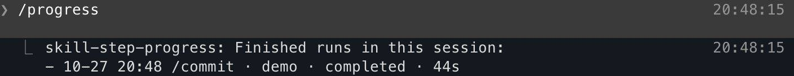

# skill-step-progress

A live pane beside the chat that shows the current step and overall progress of this session's flows, one box per run, with each step's time and the commits a run made.


## Install

```bash
claude plugin marketplace add weskao/weskao-agent-plugins
claude plugin install skill-step-progress@weskao-agent-plugins
```

Needs Claude Code 2.1.287 or later (mods load by default) and `git` on `PATH`. Works on macOS, Linux and Windows; nothing else is required.

## Use

`/progress` opens or closes the pane (`/progress open`, `/progress close`, `/progress history` lists this session's finished runs with status, time and why, `/progress forget <skill>` drops a skill from this session's list, `/progress rules` manages your flows). The pane opens on its own when a run starts. With no run in progress, it lists the flows tracked on this computer, read from your own rules file. A run that fails or is abandoned also shows a toast, so you notice it with the pane closed. You can also ask Claude in plain words to open or close the Progress pane.



It shows two kinds of runs:

- **Watched flows**: `/commit` is built in. The mod follows the commands it runs (`git add` / `git commit` → Commit batches, `git log` → Verify) and lists the commits it made, so the skill itself carries no progress calls. Commits made in another work tree count too, when the step names it (`git -C <dir>`, or `cd <dir> && …` in the same command). A sub-agent's run, such as a `/commit` a sub-agent makes, gets its own box labeled `sub-agent <id>` and ends with that sub-agent. A watched run is followed by the process that started it: one left behind by a crash, `--resume` or `/reload-plugins` mid-run is archived as abandoned ("left by an earlier process") rather than shown in progress for the rest of the session.
- **Skills that write their own state** to `~/.claude/usage-data/<skill>/<repo>/current.json` (under `CLAUDE_CONFIG_DIR` when set; archived under `history/`). The shape is `StateFileContract` in [`types/index.d.ts`](types/index.d.ts). A skill whose folder has its own name needs no setup. A command whose folder is named differently (`/orch:task` writing `orch-task`) gets a state flow in your rules file (see below).

A `/commit` run from start to finish, then its box once it is done:


## Update

When a newer version is published, a toast says so at session start (checked at most once every 10 minutes). Run `/skill-step-progress-update` to update, then restart Claude Code.

## Add your own flows

You don't need to edit any file by hand:

- **Ask Claude**, e.g. "track the steps of /deploy". Claude reads the skill, drafts its steps and the commands that start each one, checks a few real commands against the draft, and saves it. A flow that doesn't pass the check is never saved, and Claude is told why. This goes through the mod's `rules` tool (`list`, `get`, `set`, `remove`, `pause`, `resume`, `test`), which loads only when needed.
- **The pane's Rules view** (`◉ Rules` at the top of the pane) lists every flow with the reason any entry is skipped. Pause or Resume takes one press; Remove asks you to confirm.
- **`/progress rules`** lists the flows in the chat and opens the Rules view. `/progress rules show|pause|resume|remove <name>` does the rest. The built-in `/commit` can be paused but not removed.

All three keep your flows in `~/.claude/skill-step-progress/rules.json` (on Windows, `%USERPROFILE%\.claude\skill-step-progress\rules.json`; with `CLAUDE_CONFIG_DIR` set, `$CLAUDE_CONFIG_DIR/skill-step-progress/rules.json`). The file is yours and never ships with the mod, so every user and machine keeps its own. Each key is a skill or command name; an entry named `commit` replaces the built-in one, and `"off": true` pauses an entry. The file is re-read each time a skill starts and after each edit. To edit it by hand, use the format below.

```json
{
  "deploy": {
    "steps": ["Build", "Test", "Ship", "Summary"],
    "marks": [
      { "cmd": "\\b(?:npm|pnpm) test\\b", "step": 2 },
      { "cmd": "\\bmake deploy\\b", "step": 3 }
    ],
    "doneAt": 3,
    "oneTurn": true,
    "commits": "made"
  }
}
```

| Field | Meaning |
| --- | --- |
| `steps` | Step titles, in order. The run starts on step 1. |
| `marks[].cmd` | A regex source: a Bash command matching it starts `step`. Steps passed over count as done. |
| `marks[].after` | Optional: match only once the run reached this step. |
| `marks[].onError` | Optional: match only after the command ran and failed. |
| `doneAt` | A turn that ends at or past this step finishes the run as completed. |
| `oneTurn` | Optional: the flow never spans turns, so a turn ending before `doneAt` ends it as abandoned. Without it the flow may wait for you across turns, but two turns in a row in which none of its commands ran end it as abandoned ("idle at <step>"). |
| `off` | Optional: `true` pauses the flow; it stays in the file but is not tracked. |
| `commits` | Optional: `"made"` lists the commits since the run started; `"pushed"` lists what a matched push sent. |

A **state flow** maps a command to the `usage-data` folder its skill writes, for a command whose folder has another name:

```json
{
  "orch:task": { "state": "orch-task", "writer": "\\borch-progress\\.py[\"']?\\s+task(?=\\s|$)" }
}
```

| Field | Meaning |
| --- | --- |
| `state` | The `usage-data` folder the skill writes `current.json` to. Its name (the key) may keep a plugin prefix (`orch:task`). |
| `writer` | Optional: a regex source. A Bash command matching it (a call to the skill's state script) marks the flow as run, even when the command was not typed. It is matched against the whole command text, so a `git commit -m` message or an `echo` naming the script counts too. |
| `off` | Optional: `true` pauses the flow. |

An entry that does not check out (a regex that does not compile, a step number past `steps`, a name that is not a command name, a watched flow named with a plugin prefix) is skipped; the rest of the file still loads.

## Privacy

Watched flows keep their state in this session's folder under the OS per-user temp directory (`TMPDIR`, `XDG_RUNTIME_DIR` or `TEMP`; `~/.cache` when none is set). That folder also holds the session's list of skills run, so a `--resume` shows the right ones; only a flow, or a skill with state in `usage-data`, makes the list. Nothing there is kept for good: each session start removes other sessions' folders untouched for 7 days, since only macOS purges its temp dir on its own. Under the Claude Code config directory the mod keeps only your rules file. The mod reads `usage-data` and your rules file and runs `git` in the session's folder. Nothing is sent anywhere.

## License

MIT
